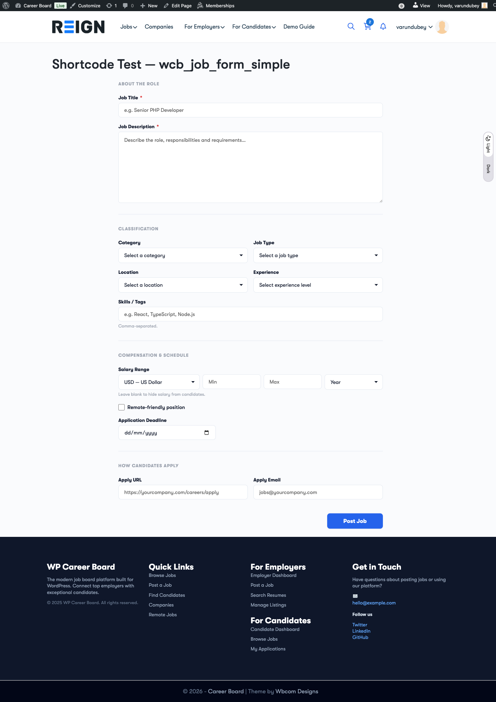
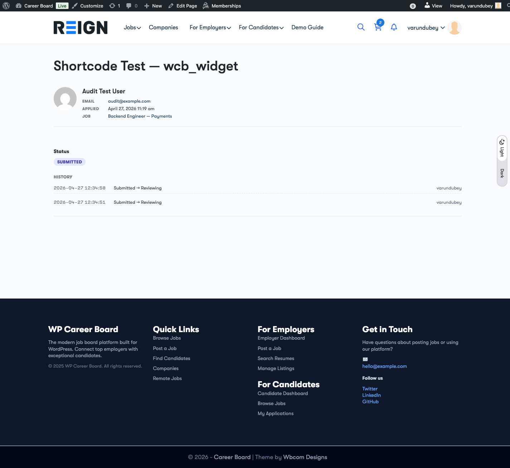

# WP Career Board - Shortcode Reference

> The maintained user-facing version of this reference is [website/for-employers/11-page-builder-embeds.md](website/for-employers/11-page-builder-embeds.md). This file is the developer working copy; if the two differ, the website page wins.

Every block in WP Career Board is also exposed as a shortcode for sites
running classic editors, page builders (Elementor, Divi, Bricks, Beaver
Builder), or theme template hooks. Shortcodes forward attributes 1:1 to the
underlying block, so anything you can do in the block inserter you can do
from a shortcode field.

> **All shortcode attributes are forwarded** - numeric strings cast to
> `int`, `"true"`/`"false"` cast to `bool`, everything else stays a
> `string`. So `[wcb_job_listings perPage="6" boardId="42"]` produces the
> same output as the block with `{perPage: 6, boardId: 42}`.

---

## New in 1.1.0

| Shortcode | What it renders | Screenshot |
|-----------|------------------|------------|
| `[wcb_job_form_simple]` | Single-page job posting form (vs. multi-step wizard) |  |
| `[wcb_widget id="application/applicant-card" application_id="123"]` | Render any registered widget on a public page |  |

The existing job-listing/job-search/dashboard shortcodes also gained
attribute forwarding in 1.1.0 - see "Shortcode attributes" below.

---

## New in 1.2.0 - full block-to-shortcode coverage

Every frontend block in Free now ships with a matching shortcode so page
builders work without leaving their surface. Five blocks that previously
had no shortcode wrapper (`featured-jobs`, `job-filters`, `job-search-hero`,
`job-single`, `company-profile`) are now usable from any shortcode host.

| Shortcode | Block | Common attributes |
|---|---|---|
| `[wcb_job_listings]` | `wp-career-board/job-listings` | `boardId`, `perPage`, `layout`, `columns`, `showFilters`, `showHeading`, `metaFilter`, `authorId`, `savedBy` |
| `[wcb_job_search]` | `wp-career-board/job-search` | (none) |
| `[wcb_job_search_hero]` | `wp-career-board/job-search-hero` | `layout`, `placeholder`, `buttonLabel`, `showCategoryFilter`, `showLocationFilter`, `showJobTypeFilter` |
| `[wcb_job_filters]` | `wp-career-board/job-filters` | (none) |
| `[wcb_job_form]` | `wp-career-board/job-form` | `boardId` (multi-step wizard) |
| `[wcb_job_form_simple]` | `wp-career-board/job-form-simple` | `boardId`, `compact` (see section below) |
| `[wcb_job_single]` | `wp-career-board/job-single` | `jobId` (override `?p` context) |
| `[wcb_employer_dashboard]` | `wp-career-board/employer-dashboard` | (auto-scoped to current user) |
| `[wcb_candidate_dashboard]` | `wp-career-board/candidate-dashboard` | (auto-scoped to current user) |
| `[wcb_employer_registration]` | `wp-career-board/employer-registration` | (none). `[wcb_registration]` is the older tag for the same block |
| `[wcb_company_archive]` | `wp-career-board/company-archive` | `perPage`, `layout` |
| `[wcb_company_profile]` | `wp-career-board/company-profile` | `companyId` (override post context) |
| `[wcb_job_stats]` | `wp-career-board/job-stats` | `showJobs`, `showCompanies`, `showCandidates` |
| `[wcb_recent_jobs]` | `wp-career-board/recent-jobs` | `count`, `title`, `showViewAll`, `viewAllUrl` |
| `[wcb_featured_jobs]` | `wp-career-board/featured-jobs` | `perPage`, `title`, `showViewAll`, `viewAllUrl` |
| `[wcb_similar_companies]` | `wp-career-board/similar-companies-card` | `title`, `count`, `companyId` |
| `[wcb_job_alert_card]` | `wp-career-board/job-alert-card` | `title`, `body`, `cta`, `url` |

An attribute the block does not declare is ignored. The attributes above are the ones each block's `block.json` and `render.php` read. Shortcode attribute names are matched without regard to case, so `perpage="9"` works too.

For blocks with context-bound attributes (`jobId`, `companyId`), pass the
attribute when the host page doesn't provide a queried-post context - e.g.
on a custom Elementor page that's not the single-job template.

---

## `[wcb_job_form_simple]` - Single-Page Job Form

A single-page sibling of the multi-step wizard (`[wcb_job_form]`). Every
field on one screen - useful for sidebars, modal embeds, partner pages,
single-page sites, and classic themes without much vertical real estate.

Submits to the same `POST /wcb/v1/jobs` REST endpoint as the wizard and
honours the same field hooks (`wcb_job_form_fields`).

### Attributes

| Name | Type | Default | What it does |
|------|------|---------|--------------|
| `boardId` | int | `0` | Scope the form to a specific board (`wcb_board` post id). When set, the new job is created on that board. `0` means "no board". |
| `compact` | bool | `false` | Render the dense layout (smaller paddings, closer field rhythm) - good for sidebar embeds. |

### Examples

```text
[wcb_job_form_simple]
[wcb_job_form_simple boardId="42"]
[wcb_job_form_simple boardId="42" compact="true"]
```

### Hooks

- `wcb_job_form_fields` - filter the form's field-group schema (shared with the wizard).
- `wcb_job_form_simple_initial_state` - extend the Interactivity API state.
- `wcb_job_form_simple_extra_fields` - render extra inputs after the built-in fields.

### When to use this vs. `[wcb_job_form]`

- **Wizard (`[wcb_job_form]`)** - best for sites where job posting is the primary CTA on its own page. Steps reduce cognitive load on long forms.
- **Single-page (`[wcb_job_form_simple]`)** - best when the form lives inside another flow (onboarding, modal, sidebar) where steps would feel heavy.

---

## `[wcb_widget]` - Mount Any Registered Widget on a Page

Renders any widget registered via `WCB\Core\Widgets\WidgetRegistry`. Every
attribute other than `id` is forwarded to the widget's render args, so the
same component renders identically inside an admin metabox or on a public
page.

### Attributes

| Name | Type | Default | What it does |
|------|------|---------|--------------|
| `id` | string | *(required)* | Widget id, e.g. `application/applicant-card`. |
| *(any other key)* | string | - | Forwarded to the widget. Common: `application_id`, `job_id`, `user_id`. |

### Built-in widget IDs

| ID | What it renders |
|----|------------------|
| `application/applicant-card` | Applicant header card (avatar, name, contact, applied job, status). |
| `application/cover-letter` | The candidate's cover letter, formatted. |
| `application/resume-preview` | Embedded PDF/HTML resume preview with download link. |
| `application/status-changer` | Dropdown to change application status (employer-only). |
| `application/status-timeline` | Timeline of every status change with timestamps. |
| `application/quick-actions` | Shortlist, mark hired, reject and message the candidate. |
| `application/custom-answers` | The applicant's answers to the job's custom application questions. |

### Examples

```text
[wcb_widget id="application/applicant-card" application_id="1234"]
[wcb_widget id="application/cover-letter" application_id="1234"]
[wcb_widget id="application/status-timeline" application_id="1234"]
```

### Why this exists

Themes that build custom application-detail pages (e.g. behind a member
paywall) can compose them out of the same widgets the admin uses, instead
of hand-rolling markup that drifts out of sync. Add a custom widget by
extending `WCB\Core\Widgets\AbstractWidget` and registering it on
`init`:

```php
add_action( 'init', function () {
    \WCB\Core\Widgets\WidgetRegistry::instance()->register( new MyApp\Widgets\InterviewNotes() );
}, 20 );
```

---

## Existing shortcodes

All of these wrap a block. Every block attribute is forwarded - see each
block's `block.json` for the full list.

### `[wcb_job_listings]` - Job Listings Grid

Reactive job grid with a **Load More** next-page link (`/find-jobs/page/2/`, so the pages work without JavaScript), a bookmark toggle and chip-bar filters.

| Attribute | Type | Default | What it does |
|-----------|------|---------|--------------|
| `perPage` | int | `0` (uses **Jobs Per Page**, 12 on a new site) | Page size for the listing. |
| `layout` | `grid` \| `list` | `grid` | Card grid or wide-row list. |
| `columns` | `3` \| `4` | `3` | Grid columns. |
| `showFilters` | bool | `true` | Show the filter panel. |
| `showHeading` | bool | `false` | Show the page heading above the list. |
| `authorId` | int | `0` | Limit to jobs posted by a specific user. |
| `savedBy` | int | `0` | Show only jobs saved/bookmarked by the given user (e.g. logged-in candidate). |
| `boardId` | int | `0` | Scope to a specific board. |
| `metaFilter` | string | `""` | Allow-listed meta filter, format `key:value` (e.g. `_wcb_partner_id:5`). The REST endpoint enforces an allow-list. |

```text
[wcb_job_listings]
[wcb_job_listings perPage="9" layout="list"]
[wcb_job_listings boardId="42" metaFilter="_wcb_partner_id:5"]
```

### `[wcb_job_search]` - Search Box

Keyword search box that wires into the job listings block via the
Interactivity API store. It has no attributes. For a hero with category,
location and job-type selects, use `[wcb_job_search_hero]`.

```text
[wcb_job_search]
```

### `[wcb_job_form]` - Multi-Step Wizard

Multi-step job-posting wizard. Same submission contract as
`[wcb_job_form_simple]`.

| Attribute | Type | Default | What it does |
|-----------|------|---------|--------------|
| `boardId` | int | `0` | Scope the new job to a board. |

```text
[wcb_job_form]
[wcb_job_form boardId="42"]
```

### `[wcb_employer_dashboard]` - Employer Dashboard

Full employer dashboard: my jobs, applications, company profile and (with Pro) credits.
The management screens render only for users granted the `wcb/manage-company` ability; everyone else sees a prompt to sign in or register as an employer.

```text
[wcb_employer_dashboard]
```

### `[wcb_candidate_dashboard]` - Candidate Dashboard

Full candidate dashboard: applications, saved jobs, resumes, alerts.
Renders only for logged-in users.

```text
[wcb_candidate_dashboard]
```

### `[wcb_employer_registration]` - Sign-up Form

Self-serve sign-up with a role picker: **Find a Job** creates a candidate
account and the hiring option creates an employer account. `[wcb_registration]`
is the older tag for the same block.

```text
[wcb_employer_registration]
```

### `[wcb_company_archive]` - Company Directory

Public listing of all companies with their open job counts.

| Attribute | Type | Default | What it does |
|-----------|------|---------|--------------|
| `perPage` | int | `20` | Companies per page. |
| `layout` | `grid` \| `list` | `grid` | Card grid or wide-row list. |

```text
[wcb_company_archive]
[wcb_company_archive perPage="12" layout="list"]
```

### `[wcb_job_stats]` - Site-Wide Stats Strip

Counts of published jobs, companies and candidates (published resumes, so
the candidate count stays 0 without Pro). Lightweight - safe to drop into
any landing page.

| Attribute | Type | Default | What it does |
|-----------|------|---------|--------------|
| `showJobs` | bool | `true` | Show the jobs count. |
| `showCompanies` | bool | `true` | Show the companies count. |
| `showCandidates` | bool | `true` | Show the candidates count. |

```text
[wcb_job_stats]
[wcb_job_stats showCandidates="false"]
```

### `[wcb_recent_jobs]` - Recent Jobs (Compact)

Compact list of the most recently published jobs. Good for sidebars and
footers.

| Attribute | Type | Default | What it does |
|-----------|------|---------|--------------|
| `count` | int | `5` | How many jobs to list. |
| `title` | string | `""` | Heading above the list. |
| `showViewAll` | bool | `true` | Show the **View all** link. |
| `viewAllUrl` | string | `""` | Where **View all** points. Empty uses the Jobs Archive Page. |

```text
[wcb_recent_jobs]
[wcb_recent_jobs count="3" title="Latest roles"]
```

### `[wcb_featured_jobs]` - Featured Jobs

Compact list of featured jobs.

| Attribute | Type | Default | What it does |
|-----------|------|---------|--------------|
| `perPage` | int | `3` | How many jobs to list. |
| `title` | string | `""` | Heading above the list. |
| `showViewAll` | bool | `true` | Show the **View all** link. |
| `viewAllUrl` | string | `""` | Where **View all** points. |

### `[wcb_job_search_hero]` - Search Hero

Search bar with optional category, location and job-type selects.

| Attribute | Type | Default | What it does |
|-----------|------|---------|--------------|
| `layout` | `horizontal` \| `vertical` | `horizontal` | Bar across the page, or stacked fields. |
| `placeholder` | string | `""` | Placeholder of the keyword field. |
| `buttonLabel` | string | `""` | Label of the search button. |
| `showCategoryFilter` | bool | `true` | Show the category select. |
| `showLocationFilter` | bool | `true` | Show the location select. |
| `showJobTypeFilter` | bool | `true` | Show the job-type select. |

### `[wcb_job_single]`, `[wcb_company_profile]`, `[wcb_similar_companies]`, `[wcb_job_alert_card]`

Pass `jobId` or `companyId` when the page is not a job or company page. `[wcb_similar_companies]` also takes `title` and `count` (default 5). `[wcb_job_alert_card]` takes `title`, `body`, `cta` and `url` to replace the card's text and link.

---

## Pro shortcodes

The Pro plugin registers parallel shortcodes for resume search, the
single-page resume form, credit balance, and job alerts. See
[`wp-career-board-pro/docs/SHORTCODES.md`](../../wp-career-board-pro/docs/SHORTCODES.md).

---

## Shortcode attributes - what gets cast where

The shortcode wrapper around every block does the following:

1. Takes the raw `$atts` array.
2. For each key/value pair:
   - `"true"` / `"false"` → `bool`
   - Numeric integer-shaped strings (`"42"`) → `int`
   - Everything else → `string`
3. JSON-encodes the result into the block comment markup so the block
   receives them as proper attribute types matching `block.json`.

So `[wcb_job_listings perPage="9"]` arrives at the block as
`{ perPage: 9 }`, not `{ perPage: "9" }` - meaning your block's
`type: "integer"` validation passes.
